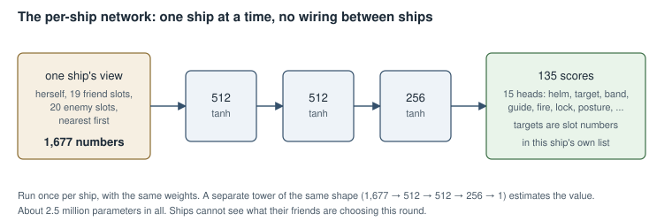
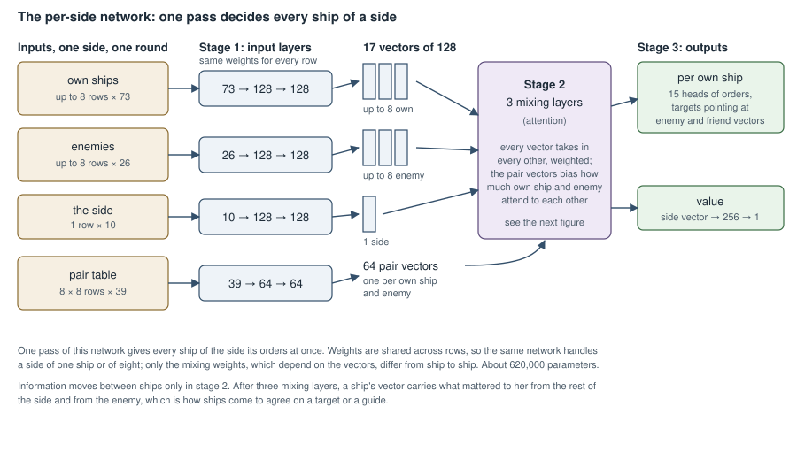
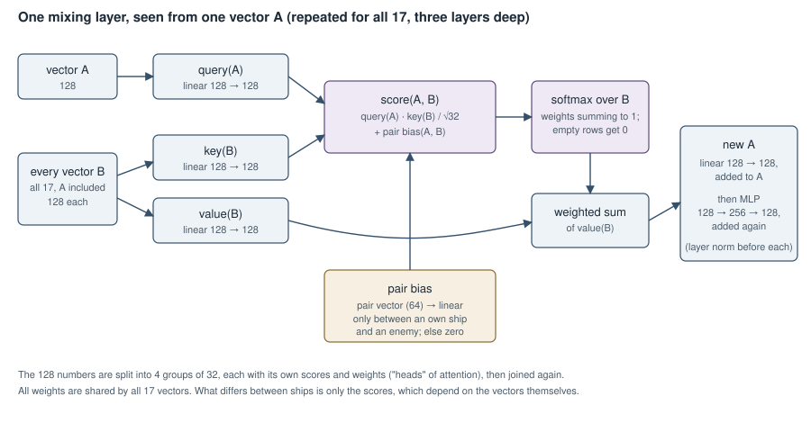
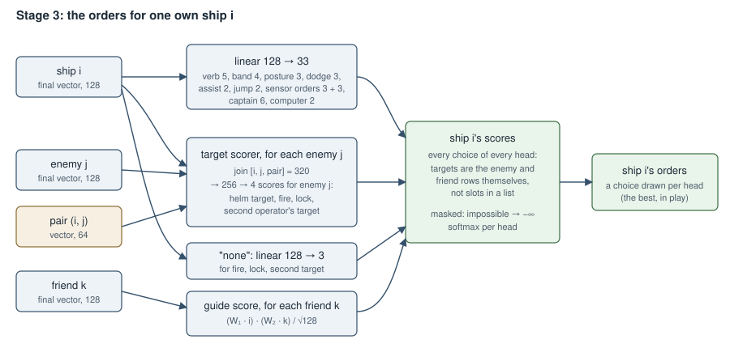

# The per-side network

How the network that commands a whole side is wired, set against the
per-ship network it replaces. The code is `rl-env/python/callisto_rl/sidenet.py`
(the network) and `rl-env/src/side.rs` (what it is given each round).

## Why a second network

The first network decided for one ship at a time. Every ship ran the same
network on its own view of the battle, and none of them could see what the
others were choosing that round. Against Gemini Flash that showed in three
habits, measured from logged games:

| | Gemini | Per-ship network |
|---|---|---|
| Targets a side fires at, per round | 1.0 | 1.5–2.1 |
| Orders that follow a guide | 62–68% | 7–25% |

Concentrating fire and flying in formation both need ships to agree, so
neither can be learned by ships that decide alone. The per-side network decides
for every ship of a side in one pass, with the ships wired to each other.

## The per-ship network, for comparison

A plain multi-layer network: one ship's view in, 1,677 numbers, through
three layers of 512, 512 and 256, out to 135 scores. Those scores are the 15
heads of orders: the helm verb and its target, the range band, the guide to
follow, the fire and lock targets, posture, dodge and the rest. Its targets
are slot numbers in that ship's own list of friends and enemies, nearest
first. It runs once per ship with the same weights, so it has no wiring
between ships at all. About 2.5 million parameters, counting the separate
tower that estimates the value.

## The per-side network

### Inputs: one side, one round

| Input | Shape | What it holds |
|---|---|---|
| Own ships | up to 8 rows × 73 | Position and velocity relative to the middle of the side, hull, armour, thrust, dodge, posture, contacts and locks, which bands its guns reach, damage, stealth, crew skills, missiles left, current burn, missiles coming at it, jump readiness, and last round's orders and damage |
| Enemies | up to 8 rows × 26 | Position and velocity relative to the side, contact or blip, hull as last seen, thrust, damage, stealth, current burn, the share of the side that fired at it last round |
| The side | 1 row × 10 | The round, the side's goal, both sides' hull left, how many ships each side has |
| Pair table | 8 × 8 rows × 39 | For each own ship and each enemy: direction, distance and closing speed, range band, contact and lock each way, the odds of hitting each way at every band, how likely the enemy is to find her if she goes silent or active, and last round's helm, fire and lock between them |

Rows no ship fills are zeros and are masked out. Eight a side covers every
scenario in the training pool; the largest side is Jupiter's Aslan at seven.
Every number in each row is listed in [the appendix](#appendix-every-input).

### Stage 1: input layers

A small network per kind of row, with the same weights applied to every row
of that kind: 73 → 128 → 128 for own ships, 26 → 128 → 128 for enemies,
10 → 128 → 128 for the side, 39 → 64 → 64 for pairs. The result is 17
vectors of 128 (eight own, eight enemy, one side) and 64 pair vectors of 64.

### Stage 2: three mixing layers

This is where ships see each other. Each layer does the same thing to every
one of the 17 vectors. For a vector A:

1. Three linear projections, 128 → 128 each: A's *query*, and every vector
   B's *key* and *value*.
2. For every B, a score: A's query times B's key, divided by √32. If A is
   one of our ships and B an enemy, or the reverse, a number made from their
   pair vector is added. Empty rows score −∞.
3. A softmax over all B turns the scores into weights that sum to one.
4. A's new vector is the weighted sum of every B's value, through a linear
   128 → 128, added to A's old vector.
5. Then each vector separately goes through a small network, 128 → 256 → 128,
   added on again.

The 128 numbers are worked in four groups of 32, each with its own scores.
Every weight is shared by all 17 vectors: what differs from ship to ship is
only the scores, which depend on the vectors themselves. After three layers,
a ship's vector carries what mattered to her from the rest of her side and
from the enemy.

### Stage 3: orders for each ship

From each own ship's final vector:

* **Ordinary heads**, a linear layer 128 → 33: the helm verb (5 choices),
  band (4), posture (3), dodge (3), assist (2), withdraw by jump (2), the
  two sensor operators' orders (3 each), the captain's ranking (6) and the
  computer (2).
* **Enemy targets**: for each enemy, her vector, the enemy's and their pair
  vector are joined (320 numbers) and scored, 320 → 256 → 4, giving that
  enemy's score as her helm target, fire target, lock target and second
  operator's target. A linear layer gives the score of "none" for fire, lock
  and the second target.
* **Guide**: for each friend, a projection of her vector times a projection
  of the friend's, divided by √128.

Scores for impossible choices are set to −∞, a softmax per head gives the
probabilities, and a choice is drawn (in play, the best is taken). Targets
are the enemy and friend vectors themselves, not slots in a list, so two
ships can pick the same target or follow the same guide simply by scoring it
highest; and several squadrons are just different guides.

**Value**: the side's final vector, 128 → 256 → 1, is the network's estimate
of how the game will go, used only in training.

## Size and cost

| | Per-ship network | Per-side network |
|---|---|---|
| Parameters | about 2.5 million | about 620,000 |
| Runs | once per ship | once per side |
| Work per decision | one pass of a plain network | every ship against every other, every own ship against every enemy |
| Training on this Mac | 14,700 ship decisions a second | 5,550 |

The per-side network is smaller because its layers are shared by every row and
do not grow with the fleet. It does more arithmetic because the mixing layers
and the target scorer run on every pairing. Its operations are large and
regular, so it learns on the Mac's GPU (the per-ship network could not use it
well) and would gain much more from an NVIDIA GPU.

The orders the network chooses are turned into the game's orders exactly as
for the per-ship network (squadrons, withdrawal by jump, the captain's
boosts, the computer and the sensor operators), by `rl-env/src/action.rs`
and `rl-env/src/orders.rs`.

## Appendix: every input

Each count below is one number in the row. Everything is scaled to about
−1 to 1. Positions and velocities are given as a direction (three numbers)
and a logarithm of the size (one), since they span a kilometre to a million.
"Relative to the side" means measured from the middle of the side's ships and
their average velocity. Shares are of the ship's design value: 0.5 hull means
half her hull left.

### Own ship: 73

| Numbers | What |
|---|---|
| 1 | present (1, or 0 for an empty row) |
| 8 | position and velocity relative to the side: direction 3, log distance 1, velocity direction 3, log speed 1 |
| 1 | hull left, as a share |
| 1 | armour |
| 1 | thrust she can make now |
| 1 | thrust she was built for |
| 1 | thrust held back to dodge |
| 1 | pilot assisting the gunners |
| 3 | posture: silent, sharing or active (one is 1) |
| 1 | how many ships she holds as contacts |
| 1 | how many she has locked |
| 5 | whether her guns reach each band: Short, Medium, Long, Very Long, Distant |
| 11 | damage to each of her 11 systems |
| 1 | stealth |
| 1 | countermeasures |
| 4 | crew: pilot, average gunner, best sensor operator, best engineer |
| 1 | missiles left, as a share of a full magazine |
| 4 | her current burn: size 1, direction 3 |
| 2 | missiles coming at her, and how soon the first arrives |
| 1 | her own missiles in flight |
| 4 | jumping: Jump Control running, jump drive powered, clear of gravity wells, distance still to clear |
| 1 | a spare point on her computer, for hand-offs |
| 1 | her comms jammed |
| 1 | a second sensor operator aboard |
| 1 | her captain's leadership |
| 5 | last round's helm verb: hold, intercept, hold range, open range, follow (one is 1) |
| 4 | last round's band: Short, Medium, Long, Very Long |
| 1 | withdrawing last round |
| 1 | hull she lost last round |
| 1 | rounds since she was last hit |
| 2 | enemies holding her as a contact, and enemies locked on her |
| 1 | her size: the logarithm of her design hull |
| **73** | |

### Enemy: 26

| Numbers | What |
|---|---|
| 1 | present |
| 1 | a contact (1) or only a blip (0) |
| 8 | position and velocity relative to the side, as for own ships |
| 1 | hull left as a share: now, for a contact; as last seen, for a blip |
| 1 | rounds since last held, for a blip |
| 1 | its size: the logarithm of its design hull |
| 1 | thrust it can make |
| 1 | damage, all systems together |
| 1 | stealth |
| 1 | countermeasures |
| 4 | its current burn: size 1, direction 3 (contacts only; a blip's burn is not on the plot) |
| 1 | the share of our side that fired at it last round |
| 1 | hull it lost last round |
| 1 | how many of our ships hold it as a contact |
| 1 | how many of our ships it holds |
| 1 | missiles it has in flight at our side |
| **26** | |

Blank for a blip: everything only a contact shows, which is its hull now,
damage, stealth, countermeasures and burn.

### The side: 10

| Numbers | What |
|---|---|
| 1 | how far through the game: round over the round limit |
| 4 | the side's goal: destroy, hold, raid or escape (one is 1) |
| 1 | our hull left, as a share of what we started with |
| 1 | the enemy's hull left, as we last saw it |
| 2 | how many ships each side has |
| 1 | missiles coming at our side |
| **10** | |

### Pair, one own ship and one enemy: 39

| Numbers | What |
|---|---|
| 1 | present (both ships there) |
| 4 | from her to it: direction 3, log distance 1 |
| 1 | how fast they are closing (negative when opening) |
| 1 | the range band between them |
| 4 | she holds it as a contact; she has it locked; it holds her; it has her locked |
| 10 | her guns against it, at each of the five bands: best chance to hit 5, expected damage as a share of its hull 5 |
| 10 | its guns against her, the same 10 (its gunners assumed skill 2, as the models are told) |
| 4 | the chance it finds her this round if she is silent, sharing, active, and active while firing |
| 3 | last round: she steered by it, fired at it, locked it |
| 1 | missiles it has in flight at her |
| **39** | |

The pair table carries what depends on both ships at once, the odds above
all. The mixing layers use it to decide how much each own ship and enemy
attend to each other, and the target scorer uses it to score each enemy for
each ship.
