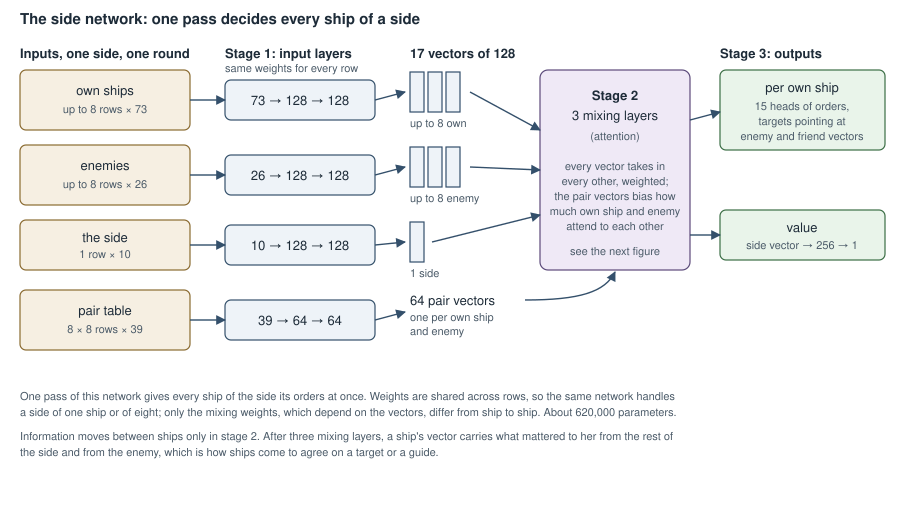

# The side network

How the network that commands a whole side is wired, set against the
per-ship network it replaces. The code is `rl-env/python/callisto_rl/sidenet.py`
(the network) and `rl-env/src/side.rs` (what it is given each round).

## Why a second network

The first network decided for one ship at a time. Every ship ran the same
network on its own view of the battle, and none of them could see what the
others were choosing that round. Against Gemini Flash that showed in three
habits, measured from logged games:

| | Gemini | Per-ship network |
|---|---|---|
| Targets a side fires at, per round | 1.0 | 1.5–2.1 |
| Orders that follow a guide | 62–68% | 7–25% |

Concentrating fire and flying in formation both need ships to agree, so
neither can be learned by ships that decide alone. The side network decides
for every ship of a side in one pass, with the ships wired to each other.

## The per-ship network, for comparison

A plain multi-layer network: one ship's view in, 1,677 numbers, through
three layers of 512, 512 and 256, out to 135 scores. Those scores are the 15
heads of orders: the helm verb and its target, the range band, the guide to
follow, the fire and lock targets, posture, dodge and the rest. Its targets
are slot numbers in that ship's own list of friends and enemies, nearest
first. It runs once per ship with the same weights, so it has no wiring
between ships at all. About 2.5 million parameters, counting the separate
tower that estimates the value.

## The side network

### Inputs: one side, one round

| Input | Shape | What it holds |
|---|---|---|
| Own ships | up to 8 rows × 73 | Position and velocity relative to the middle of the side, hull, armour, thrust, dodge, posture, contacts and locks, which bands its guns reach, damage, stealth, crew skills, missiles left, current burn, missiles coming at it, jump readiness, and last round's orders and damage |
| Enemies | up to 8 rows × 26 | Position and velocity relative to the side, contact or blip, hull as last seen, thrust, damage, stealth, current burn, the share of the side that fired at it last round |
| The side | 1 row × 10 | The round, the side's goal, both sides' hull left, how many ships each side has |
| Pair table | 8 × 8 rows × 39 | For each own ship and each enemy: direction, distance and closing speed, range band, contact and lock each way, the odds of hitting each way at every band, how likely the enemy is to find her if she goes silent or active, and last round's helm, fire and lock between them |

Rows no ship fills are zeros and are masked out. Eight a side covers every
scenario in the training pool; the largest side is Jupiter's Aslan at seven.

### Stage 1: input layers

A small network per kind of row, with the same weights applied to every row
of that kind: 73 → 128 → 128 for own ships, 26 → 128 → 128 for enemies,
10 → 128 → 128 for the side, 39 → 64 → 64 for pairs. The result is 17
vectors of 128 (eight own, eight enemy, one side) and 64 pair vectors of 64.

### Stage 2: three mixing layers

This is where ships see each other. Each layer does the same thing to every
one of the 17 vectors. For a vector A:

1. Three linear projections, 128 → 128 each: A's *query*, and every vector
   B's *key* and *value*.
2. For every B, a score: A's query times B's key, divided by √32. If A is
   one of our ships and B an enemy, or the reverse, a number made from their
   pair vector is added. Empty rows score −∞.
3. A softmax over all B turns the scores into weights that sum to one.
4. A's new vector is the weighted sum of every B's value, through a linear
   128 → 128, added to A's old vector.
5. Then each vector separately goes through a small network, 128 → 256 → 128,
   added on again.

The 128 numbers are worked in four groups of 32, each with its own scores.
Every weight is shared by all 17 vectors: what differs from ship to ship is
only the scores, which depend on the vectors themselves. After three layers,
a ship's vector carries what mattered to her from the rest of her side and
from the enemy.

### Stage 3: orders for each ship

From each own ship's final vector:

* **Ordinary heads**, a linear layer 128 → 33: the helm verb (5 choices),
  band (4), posture (3), dodge (3), assist (2), withdraw by jump (2), the
  two sensor operators' orders (3 each), the captain's ranking (6) and the
  computer (2).
* **Enemy targets**: for each enemy, her vector, the enemy's and their pair
  vector are joined (320 numbers) and scored, 320 → 256 → 4, giving that
  enemy's score as her helm target, fire target, lock target and second
  operator's target. A linear layer gives the score of "none" for fire, lock
  and the second target.
* **Guide**: for each friend, a projection of her vector times a projection
  of the friend's, divided by √128.

Scores for impossible choices are set to −∞, a softmax per head gives the
probabilities, and a choice is drawn (in play, the best is taken). Targets
are the enemy and friend vectors themselves, not slots in a list, so two
ships can pick the same target or follow the same guide simply by scoring it
highest; and several squadrons are just different guides.

**Value**: the side's final vector, 128 → 256 → 1, is the network's estimate
of how the game will go, used only in training.

## Size and cost

| | Per-ship network | Side network |
|---|---|---|
| Parameters | about 2.5 million | about 620,000 |
| Runs | once per ship | once per side |
| Work per decision | one pass of a plain network | every ship against every other, every own ship against every enemy |
| Training on this Mac | 14,700 ship decisions a second | 5,550 |

The side network is smaller because its layers are shared by every row and
do not grow with the fleet. It does more arithmetic because the mixing layers
and the target scorer run on every pairing. Its operations are large and
regular, so it learns on the Mac's GPU (the per-ship network could not use it
well) and would gain much more from an NVIDIA GPU.

The orders the network chooses are turned into the game's orders exactly as
for the per-ship network (squadrons, withdrawal by jump, the captain's
boosts, the computer and the sensor operators), by `rl-env/src/action.rs`
and `rl-env/src/orders.rs`.
